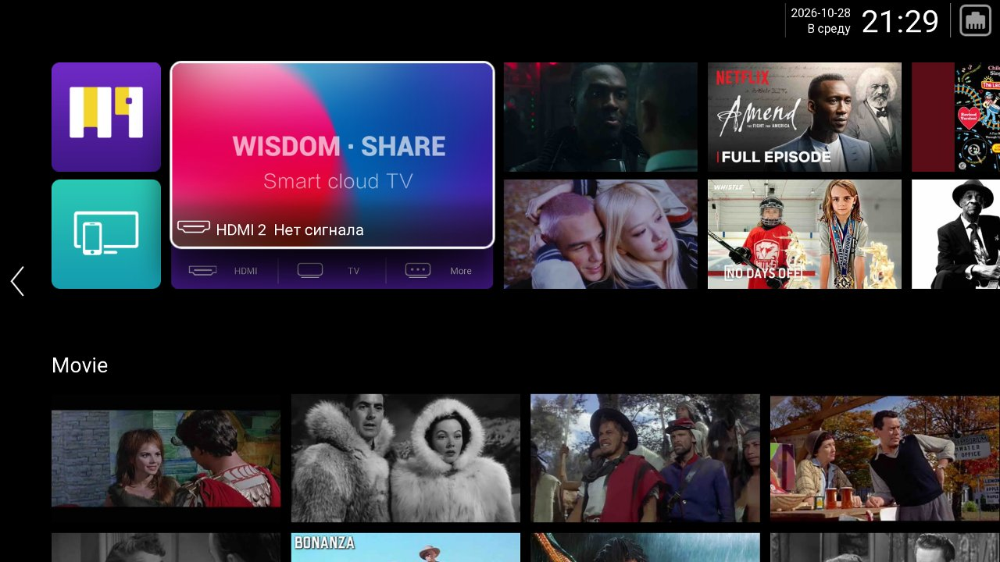
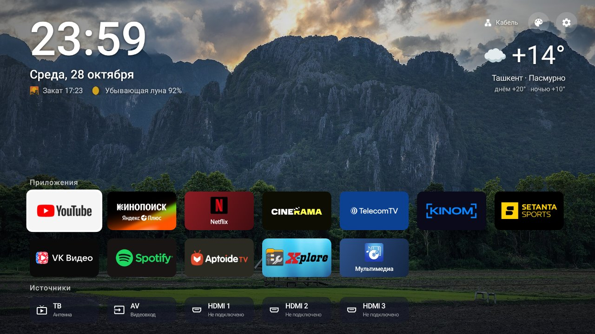
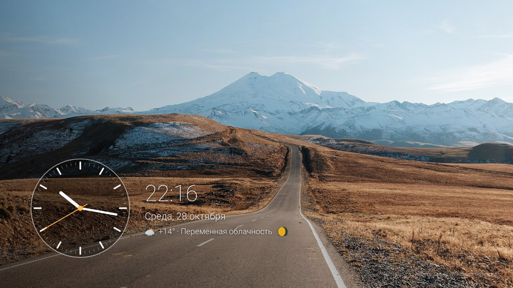
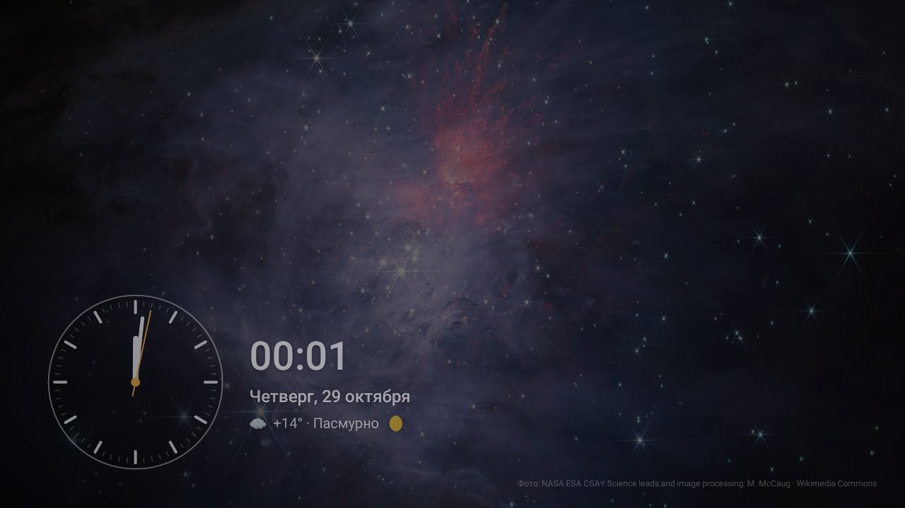

# TV Home — lightweight Android TV launcher for CVTE / MediaTek TVs

**Ad-free custom home screen (launcher) for budget Android TV sets built on CVTE boards with MediaTek MT5510 (Android 7.0, 1 GB RAM).**
Replaces the slow stock CVTE launcher full of ads with a fast, clean one: wallpapers, weather, screensaver with an analog clock,
TV / HDMI / AV inputs. **No root required.** APK ≈ 80 KB, no third-party libraries.

> 🇷🇺 [Русская версия ниже](#-по-русски)

## Before / After

| Before — stock CVTE launcher | After — TV Home |
|---|---|
|  |  |

| Screensaver | Night mode |
|---|---|
|  |  |

## Features

- 🖼 **Wallpapers** — Wikimedia Commons featured pictures (landscapes, sunsets, cities, space), rotated every 20 min, cached offline
- 🌤 **Weather** — Open-Meteo (no API key), city detected by IP; sunset time and moon phase
- 📺 **TV inputs** — Antenna TV, AV, HDMI 1–3 via the CVTE firmware service; opens the native TV screen so Home / Source / channel keys work
- 🔌 **Auto-HDMI** — switches to an HDMI input when a device is plugged in and turned on
- 🎵 **Now playing** — cover art and controls for Spotify, YouTube and other media sessions
- 🌙 **Screensaver** — Ken Burns slideshow, analog clock, weather; dimmed space photos at night (23:00–06:00)
- ⏻ **Auto power-off** — turns the TV off after N hours of screensaver via the firmware sleep timer (any key cancels)
- ⭐ **Continue watching** — last opened app goes first; Menu key on a tile: move first / hide / uninstall

## Supported hardware

Tested on **CVTE TP.MT5510S.PB803** (MediaTek MT5510, Mali-450 MP, 1920×1080 @ 50 Hz, Android 7.0 userdebug).
Should work on other CVTE-based Android TVs that ship the `cn.cvte.tv.api` firmware library (`com.cvte.tv.api.impl` service).
On non-CVTE Android TV devices everything except the TV-input row works.

## Performance on a 2013-era GPU (Mali-450, 50 Hz → 20 ms frame budget)

| Metric | First version | Now |
|---|---|---|
| Frame time while navigating (median) | 48 ms | 12–16 ms |
| Screensaver | 50 fps, 22 ms/frame | ~15 fps, 5 ms/frame |
| Launcher memory (PSS) | 45–51 MB | 22–37 MB |
| Launcher cold start | ~3.8 s | ~0.7 s |

How: background and scrim baked into one bitmap; banners pre-scaled and pre-rounded (no `clipToOutline`);
no `elevation` shadows or `withLayer()`; focus ring drawn in `onDrawForeground` (no relayout);
screensaver pan/zoom stepped every 80 ms; tile cache on disk; AOT compilation (`cmd package compile -m speed`).

## Build

Requires JDK 17 and Android SDK (platform 34, build-tools 34).

```bash
cd launcher
echo "sdk.dir=/path/to/android-sdk" > local.properties
./gradlew assembleRelease
```

The APK is signed with the debug key — intended for your own TV.

## Install on the TV

1. Enable ADB over network: **Settings → Menu → 1147** (CVTE factory menu) → **DEBUG → ADB ENABLE = ON**, then power-cycle the TV.
   ⚠️ Do not touch items marked `>>>` in the factory menu — they execute immediately (factory reset, burn-in mode).
2. Install and set as the default home screen:

```bash
adb connect <TV-IP>:5555
adb install -r app-release.apk
adb shell cmd package compile -m speed -f io.github.darkknightsoul.tvlauncher
adb shell cmd package set-home-activity io.github.darkknightsoul.tvlauncher/.MainActivity
```

3. Optional, for the “Now playing” card:

```bash
adb shell settings put secure enabled_notification_listeners io.github.darkknightsoul.tvlauncher/.MediaListener
```

**Revert to the stock launcher:**

```bash
adb shell cmd package set-home-activity com.cvte.tv.launcher.fall/com.cvte.tv.launcher.NebulaFallActivity
```

## Firmware notes

How the CVTE firmware handles TV inputs, the Home key and the sleep timer — and which preinstalled
packages are safe to disable — see **[docs/cvte-firmware.md](docs/cvte-firmware.md)**.

## Privacy

Network access only to `commons.wikimedia.org` / `upload.wikimedia.org` (wallpapers), `api.open-meteo.com` (weather)
and `ipwho.is` (city for weather). Android 7 lacks the new Let's Encrypt roots, so ISRG Root X1/X2 are bundled in
`res/raw` and trusted via `network_security_config` for this app only.

## License

[MIT](LICENSE)

---

## 🇷🇺 По-русски

**Лёгкий лаунчер (главный экран) без рекламы для бюджетных Android TV телевизоров на платах CVTE / MediaTek MT5510 (Android 7.0).**
Заменяет медленный заводской лаунчер CVTE с рекламой: обои, погода, заставка с круглыми часами, входы ТВ / HDMI / AV.
**Root не нужен.** APK ≈ 80 КБ, без сторонних библиотек.

**Возможности:** обои Wikimedia (пейзажи, закаты, города, космос), погода по городу из IP, закат и фаза луны;
ТВ (антенна), AV, HDMI 1–3 через сервис прошивки CVTE — открываются в её родном ТВ-экране, где работают Home, Source и каналы;
авто-переход на HDMI при подключении устройства; «Сейчас играет» для Spotify / YouTube; заставка с медленным наездом камеры,
ночной режим, автоотключение ТВ по таймеру сна; последнее открытое приложение — первым.

**Установка:** заводское меню **Настройки → Menu → 1147 → DEBUG → ADB ENABLE = ON**, перезагрузить ТВ из розетки,
затем команды из раздела [Install on the TV](#install-on-the-tv). Пункты заводского меню со стрелкой `>>>` не нажимать.

Заметки о прошивке CVTE (источники, кнопка Home, таймер сна, что можно отключать) — в [docs/cvte-firmware.md](docs/cvte-firmware.md).

<sub>Keywords: Android TV launcher, custom launcher, CVTE, MediaTek MT5510, MT5510S, TP.MT5510S.PB803, Android 7, smart TV,
remove ads, debloat, replace stock launcher, no root, home screen, leanback, screensaver, лаунчер для телевизора, Android TV без рекламы.</sub>
